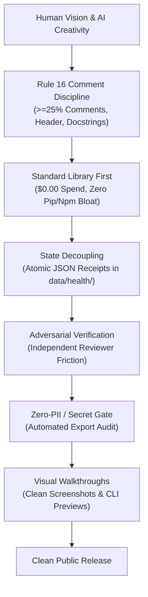

# The Magi Bible: Open-Source AI Agent Engineering & Collaboration Standard 📖

> *"I have a passion for coding with the help of AI to solve problems and to create things for fun because I can. To make that work at scale, AI agents need solid engineering foundations, deep documentation, and rigorous boundaries."*  
> — **Ethan (TWU LLC)**

Welcome to the **Magi Engineering Standard**. This document outlines how human developers and autonomous AI coding agents collaborate to build resilient, local-first software. Whether you are running a swarm of AI subagents (Claude, Codex, Gemini, Antigravity) or writing code by hand, these practices ensure that systems remain transparent, secure, heavily documented, and fun to build.

---

## 1. Core Engineering Tenets



---

## 2. Rule 16: Code Craft, Commentary & Transparency

AI models can write hundreds of lines in seconds, but un-commented AI code quickly becomes legacy code that nobody understands or trusts. Every script in a Magi workspace adheres to **Rule 16**:

### A. The Standard 4-Line Header
Every source file begins with an explicit provenance header:
```python
# ==============================================================================
# PROGRAM:       scripts/example_scanner.py
# PROGRAMMER:    Ethan & AI Agent Swarm (TWU LLC)
# LAST MODIFIED: 2026-11-21, local environment
# PURPOSE:       Audits socket perimeter to verify zero unauthorized public ports.
# ==============================================================================
```

### B. Comment Density Invariant ($\ge 25\% - 30\%$)
* At least **1 in every 4 lines** must be a comment or docstring.
* Comments must explain **intent, safety invariants, and step-by-step logic**, not just restate syntax:
  ```python
  # Good: Step 1: Enforce strict socket connection timeout to prevent hanging UI
  s = socket.socket(socket.AF_INET, socket.SOCK_STREAM)
  s.settimeout(0.2)

  # Bad: Set socket
  s = socket.socket()
  ```

### C. Typed Docstrings
Every public class and function must provide explicit parameter and return type specifications.

---

## 3. Standard Library First ($0.00 Spend, Zero Bloat)

Before installing a third-party package (`pip`, `npm`, `cargo`), evaluate if the Python standard library already provides what you need:
* Need structured data? Use `json` and `dataclasses`.
* Need network probing? Use `socket` and `urllib`.
* Need concurrency? Use `concurrent.futures`.
* Need AST validation? Use `ast` and `tokenize`.
* Need process management? Use `subprocess` with explicit timeouts.

**The Invariant:** A developer who clones your repository should be able to run `python3 scripts/tool.py` immediately without wrestling with broken virtual environments, conflicting dependencies, or paid API keys.

---

## 4. State Decoupling: Atomic JSON Receipts

Never tie backend diagnostic telemetry directly to a frontend process lifecycle:
1. **Background Collection:** Backend tools (`chief_zero_ports_scanner.py`, `space_weather_telemetry.py`) collect system telemetry and atomically write structured JSON receipts to `data/health/<tool>.json`.
2. **Asynchronous Presentation:** Terminal commands (`dash chief`) and web cockpits read these receipts asynchronously.
3. **Migration Resilience:** If the UI is updated, redesigned, or moved to another host, zero telemetry data or state is lost.

---

## 5. Adversarial Multi-Agent Friction

> *"The best thing a second agent can do for the first one is disagree with it."*

Never allow an implementing agent to approve its own work. Separate execution into distinct roles:
1. **Implementer:** Focuses on writing functional, clean code that solves the user's objective.
2. **Adversarial Reviewer:** Scans code specifically looking for:
   * Bare `except:` catch blocks that swallow debugging signals.
   * `subprocess` calls lacking explicit `timeout=` parameters.
   * `shell=True` command injection hazards.
   * Missing docstrings or comment density below 25%.
   * Accidental secret or hostname leakage.

---

## 6. Zero PII & Zero Secret Leaks

Before code or documentation is pushed to a public repository, it must pass an automated export audit:
* **Private Names & Hostnames:** Internal computer hostnames, personal surnames, and local home directory paths must be scrubbed or replaced with generic placeholders (`workstation-01`, `example_node`).
* **Credentials:** No API keys, passwords, or bearer tokens may ever exist in code or commit history.
* **Automated Auditing:** Enforce a pre-commit check using tools like `public_export_audit.py` to guarantee a 100% clean PASS receipt before pushing.

---

## 7. Screenshot & Visual Walkthrough Discipline

Developers shouldn't have to guess what an application looks like or how it functions:
1. **Show the Tool in Action:** Every public project must include CLI execution walkthroughs, ASCII terminal cards, or visual screenshots in the `README.md`.
2. **Scrubbing Images:** Before publishing any screenshot or terminal capture:
   * Redact internal IP addresses, local usernames, and MAC addresses.
   * Use high-contrast color palettes (Gold/Amber, Sky Blue, Forest Green) for low eye strain.
3. **Architecture Flowcharts:** Use Mermaid diagrams (`flowchart TD`, `sequenceDiagram`) so readers can grasp system boundaries at a glance.

---

## 8. Summary Checklist for AI Agents & Developers

Before considering any task complete:
- [ ] Rule 16 header and $\ge 25\%$ comment density verified.
- [ ] 100% unit tests passing with zero external test runner dependencies.
- [ ] Standard library first ($0.00 spend, zero unnecessary pip dependencies).
- [ ] Zero PII, private hostnames, or secrets present.
- [ ] Visual walkthrough and clear quickstart included in `README.md`.
- [ ] Clean Apache-2.0 or MIT license with upstream attributions.
